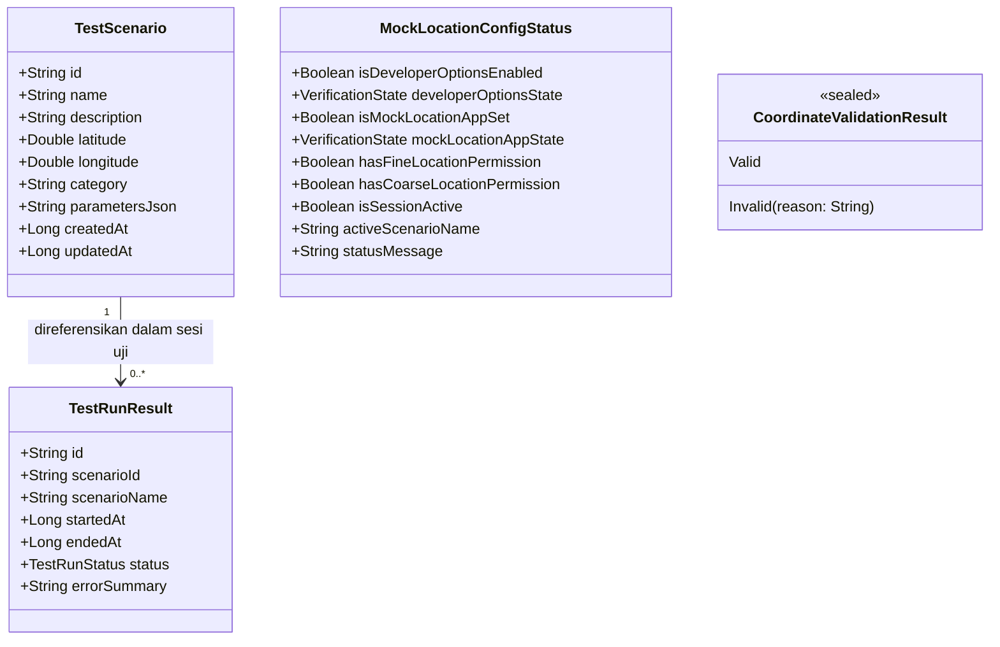

# 📍 Mari Location Lab (Location QA Simulator)
> Simulator QA lokasi resmi berbasis Android untuk pengujian aplikasi yang dapat direproduksi, transparan, dan patuh terhadap kebijakan sistem.

[](https://developer.android.com)
[](https://kotlinlang.org)
[](https://developer.android.com/jetpack/compose)
[](https://m3.material.io)
[-0078D4?style=for-the-badge)](https://developer.android.com/about/versions/15)
[-555555?style=for-the-badge)](https://developer.android.com/about/dashboards)
[-16A34A?style=for-the-badge&logo=checkmarx&logoColor=white)](app/src/test/java/com/maripartner/locationqa)
[](docs/03-developer-guide.md)
[](LICENSE)

---

## 📑 Daftar Isi

- [📖 Tentang Proyek](#-tentang-proyek)
- [🛠️ Teknologi & Library](#-teknologi--library)
- [🗄️ Model Data Domain](#-model-data-domain)
- [👥 Konfigurasi Sistem & Izin Akses](#-konfigurasi-sistem--izin-akses)
- [✨ Fitur Utama & Roadmap Tahapan](#-fitur-utama--roadmap-tahapan)
- [📋 Prasyarat Sistem](#-prasyarat-sistem)
- [🚀 Panduan Instalasi & Menjalankan](#-panduan-instalasi--menjalankan)
- [💻 Panduan Penggunaan Cepat](#-panduan-penggunaan-cepat)
- [🧪 Matriks Skenario QA Wajib](#-matriks-skenario-qa-wajib)
- [🛡️ Batasan Etika & Kepatuhan Google Play](#-batasan-etika--kepatuhan-google-play)
- [📚 Dokumentasi Lengkap](#-dokumentasi-lengkap)
- [🤝 Panduan Kontribusi](#-panduan-kontribusi)
- [📄 Lisensi](#-lisensi)

---

## 📖 Tentang Proyek

**Mari Location Lab** (Location QA Simulator) adalah aplikasi Android open-source yang dirancang untuk membantu mobile software engineer dan QA tester dalam menguji perilaku aplikasi berbasis lokasi pada kondisi yang dapat direproduksi secara konsisten.

### Masalah yang Diselesaikan:
- **Pengujian Lapangan Berbiaya Tinggi**: Menghilangkan kebutuhan mobilitas fisik untuk menguji fitur geofencing, radius absensi, rute logistik, dan zona pengiriman.
- **Inkonsistensi Data Uji**: Memungkinkan tim QA mendefinisikan titik koordinat baku dan skenario pengujian yang dapat disimpan dan digunakan ulang kapan saja.
- **Penyalahgunaan & Risiko Keamanan**: Banyak aplikasi "Fake GPS" publik memuat iklan agresif, membutuhkan root, atau menyamarkan status simulasi. Mari Location Lab mengedepankan **transparansi pengujian 100%**: menggunakan mekanisme mock location resmi Android, tidak memanipulasi data aplikasi pihak ketiga, dan menyimpan seluruh data secara lokal tanpa server cloud.

---

## 🛠️ Teknologi & Library

Proyek ini dibangun secara modern menggunakan fondasi Android Native terkini:

| Area | Pilihan Teknologi | Versi | Keterangan |
|---|---|---|---|
| **Bahasa** | Kotlin | `2.0.21` | Bahasa utama dengan type-safety ketat |
| **UI Toolkit** | Jetpack Compose | BOM `2024.10.00` | Antarmuka deklaratif modern |
| **Design System** | Material 3 | `1.3.0` | Dukungan Dynamic Color, Light & Dark Theme |
| **Arsitektur** | Clean Architecture + MVVM | - | Pemisahan Presentation, Domain, Data, & Platform |
| **Navigasi** | Navigation Compose | `2.8.3` | Transisi antar-layar berbasis type-safe route |
| **Asynchronous** | Kotlin Coroutines & Flow | `1.8.1` | Pengelolaan background state & reaktivitas data |
| **Penyimpanan Lokal** | Room Database & DataStore | `2.6.1` / `1.1.1` | Persistensi skenario lokal (Tahap 3) |
| **Peta** | OpenStreetMap (OSM) | - | Renderer peta interaktif bebas biaya vendor (Tahap 2) |
| **Build System** | Gradle Kotlin DSL | `8.7` | Konfigurasi deklaratif skrip build |
| **Testing** | JUnit 4 & Coroutines Test | `4.13.2` / `1.8.1` | Pengujian unit otomatis (19 skenario lulus 100%) |

---

## 🗄️ Model Data Domain

Arsitektur aplikasi memisahkan entitas domain murni dari dependensi database atau UI Android:



---

## 👥 Konfigurasi Sistem & Izin Akses

Aplikasi ini menggunakan mekanisme pengujian resmi Android dan memerlukan konfigurasi berikut:

### Izin Manifest Android:
- `android.permission.ACCESS_FINE_LOCATION`: Untuk membaca posisi GPS presisi tinggi saat verifikasi kesiapan pengujian.
- `android.permission.ACCESS_COARSE_LOCATION`: Untuk estimasi lokasi berbasis jaringan.
- `android.permission.INTERNET` & `ACCESS_NETWORK_STATE`: Untuk mengunduh tile OpenStreetMap secara legal.

### Konfigurasi Perangkat (Opsi Pengembang):
1. Masuk ke **Pengaturan Perangkat** > **Tentang Ponsel** (*About Phone*).
2. Ketuk **Nomor Versi** (*Build Number*) sebanyak **7 kali** hingga Opsi Pengembang aktif.
3. Buka **Pengaturan** > **Sistem** > **Opsi Pengembang** (*Developer Options*).
4. Pilih menu **Pilih aplikasi lokasi tiruan** (*Select mock location app*).
5. Pilih **Mari Location Lab**.

---

## ✨ Fitur Utama & Roadmap Tahapan

Pengembangan Mari Location Lab dibagi menjadi 5 tahapan terstruktur:

- [x] **Tahap 1: Fondasi Proyek & Dashboard Transparan (Selesai)**
  - Konfigurasi Gradle Kotlin DSL, SDK 35, Min SDK 26, Application ID `com.maripartner.locationqa`.
  - Tema Material 3 dengan dukungan Light & Dark Mode, tipografi baku, dan token warna kontras tinggi.
  - Dashboard interaktif dengan evaluasi status Opsi Pengembang, Aplikasi Mock, dan Izin Lokasi.
  - Formulir validasi koordinat geografis manual (latitude `-90..90`, longitude `-180..180`).
  - Standarisasi UI States: `LoadingView`, `EmptyStateView`, `ErrorStateView`.
  - Unit test suite (19 skenario lulus 100%) dan verifikasi runtime di emulator Android (Pixel 7, API 36).
- [ ] **Tahap 2: Integrasi Peta OpenStreetMap (Next)**
  - Render peta OSM interaktif dengan penanda (*marker*) lokasi.
  - Pemilihan titik koordinat melalui ketukan peta.
  - Penanganan tile error, kondisi jaringan lambat, dan kepatuhan atribusi ODbL.
- [ ] **Tahap 3: Persistensi Skenario Uji (Room Database)**
  - CRUD lengkap skenario pengujian (buat, baca, ubah, duplikasi, hapus).
  - Pengelompokan kategori skenario (Geofence, Logistik, Peta, dsb.).
  - Dialog konfirmasi aksi destruktif & migrasi database Room.
- [ ] **Tahap 4: Mesin Simulasi Mock Location & Riwayat Sesi**
  - Injeksi koordinat tiruan menggunakan Android LocationManager Mock Provider resmi.
  - Kontrol sesi simulasi: Mulai, Berhenti, Status berjalan.
  - Pencatatan log sesi riwayat (waktu mulai/selesai, status, error) tanpa mencatat GPS riil pengguna.
- [ ] **Tahap 5: Kesiapan Rilis Google Play Store**
  - Audit permissions manifest, penandatanganan paket AAB rilis.
  - Deklarasi Data Safety & Privacy Policy tanpa cloud storage.

---

## 📋 Prasyarat Sistem

Untuk mengompilasi dan mengembangkan proyek ini di komputer lokal:

- **Sistem Operasi**: Windows 10/11, macOS, atau Linux
- **Java Development Kit (JDK)**: OpenJDK 21 LTS (direkomendasikan versi bundled Android Studio / JBR 21)
- **Android Studio**: Android Studio Koala / Ladybug / Meerkat (versi 2024.1+)
- **Android SDK Platform**: API Level 35 (Android 15) dan Build-Tools 35.0.0
- **Emulator / Perangkat Uji**: Emulator Android (API 26 s/d 36) atau smartphone Android fisik dengan kabel data/USB debugging aktif.

---

## 🚀 Panduan Instalasi & Menjalankan

### 1. Clone Repositori
```bash
git clone https://github.com/maripartner/mari-location-lab.git
cd mari-location-lab
```

### 2. Konfigurasi `local.properties`
Pastikan file `local.properties` menunjuk ke direktori Android SDK lokal Anda:
```properties
# Contoh pada Windows:
sdk.dir=C\:\\Users\\Username\\AppData\\Local\\Android\\Sdk

# Contoh pada macOS/Linux:
# sdk.dir=/Users/username/Library/Android/sdk
```

### 3. Kompilasi & Jalankan Pengujian Unit
```bash
# Menjalankan seluruh 19 skenario pengujian unit otomatis
./gradlew test

# Menjalankan build APK Debug
./gradlew assembleDebug
```

### 4. Instal ke Emulator / Perangkat Nyata via ADB
```bash
# Pastikan emulator atau ponsel terhubung
adb devices

# Instal APK hasil build
adb install -r app/build/outputs/apk/debug/app-debug.apk

# Jalankan aplikasi secara langsung
adb shell am start -n com.maripartner.locationqa/.MainActivity
```

---

## 💻 Panduan Penggunaan Cepat

1. **Dashboard**: Buka aplikasi untuk melihat status kesiapan perangkat. Jika Opsi Pengembang atau Aplikasi Lokasi Tiruan belum aktif, ikuti petunjuk yang tertera pada kartu status.
2. **Peta & Koordinat**: Masuk ke tab **Peta** untuk mencoba formulir validasi koordinat manual. Masukkan angka desimal (contoh: `-6.2088` dan `106.8456`) lalu tekan **Validasi Nilai Koordinat**. Aplikasi akan menampilkan status valid hijau atau pesan kesalahan merah jika nilai di luar batas rentang.
3. **Skenario**: Masuk ke tab **Skenario** untuk melihat daftar titik uji terstandarisasi (contoh: Monas Jakarta Pusat atau Tugu Pahlawan Surabaya).
4. **Pengaturan**: Masuk ke tab **Pengaturan** untuk membaca panduan rinci konfigurasi Opsi Pengembang perangkat dan batasan etika pengujian.

---

## 🧪 Matriks Skenario QA Wajib

Pengujian unit dan integrasi proyek mencakup skenario batas (*boundary testing*) berikut:

| Skenario Pengujian | Input Koordinat | Hasil yang Diharapkan | Status Uji |
|---|---|---|:---:|
| **Khatulistiwa & Meridian Nol** | Lat: `0.0`, Lon: `0.0` | Diterima sebagai koordinat valid | ✅ Lulus |
| **Titik Pusat Jakarta (Monas)** | Lat: `-6.175392`, Lon: `106.827153` | Diterima sebagai koordinat valid | ✅ Lulus |
| **Batas Maksimum Latitude** | Lat: `90.0`, Lon: `100.0` | Diterima sebagai koordinat valid | ✅ Lulus |
| **Batas Minimum Latitude** | Lat: `-90.0`, Lon: `100.0` | Diterima sebagai koordinat valid | ✅ Lulus |
| **Batas Maksimum Longitude** | Lat: `10.0`, Lon: `180.0` | Diterima sebagai koordinat valid | ✅ Lulus |
| **Batas Minimum Longitude** | Lat: `10.0`, Lon: `-180.0` | Diterima sebagai koordinat valid | ✅ Lulus |
| **Latitude Melebihi Batas** | Lat: `90.0001`, Lon: `100.0` | Ditolak: "Latitude harus berada di antara -90.0 dan 90.0" | ✅ Lulus |
| **Longitude Melebihi Batas** | Lat: `10.0`, Lon: `180.0001` | Ditolak: "Longitude harus berada di antara -180.0 dan 180.0" | ✅ Lulus |
| **Input Bukan Angka (String)** | Lat: `"abc"`, Lon: `"106.8"` | Ditolak: "Format latitude tidak valid" | ✅ Lulus |
| **Input Kosong** | Lat: `""`, Lon: `"100.0"` | Ditolak: "Latitude tidak boleh kosong" | ✅ Lulus |
| **Input Angka Khusus NaN / Inf** | Lat: `NaN`, Lon: `Infinity` | Ditolak sebagai angka tidak valid | ✅ Lulus |

---

## 🛡️ Batasan Etika & Kepatuhan Google Play

Mari Location Lab tunduk pada batasan etika pengujian perangkat lunak:
- ❌ **Dilarang Bypass**: Tidak menyediakan fitur untuk mengelabui deteksi mock location pada aplikasi pihak ketiga.
- ❌ **Dilarang Manipulasi**: Tidak dirancang untuk memalsukan data absensi/kehadiran atau mengakali game berbasis lokasi.
- ❌ **Tanpa Akses Root**: Beroperasi sepenuhnya di lingkungan Android standar tanpa modifikasi ROM berbahaya.
- 🔒 **Privasi Mutlak**: Koordinat riil perangkat pengguna tidak pernah direkam, disimpan, atau dikirimkan ke mana pun.

---

## 📚 Dokumentasi Lengkap

Dokumentasi teknis proyek tersusun rapi di dalam direktori [`docs/`](docs/README.md):
- [📖 Portal Dokumentasi (Hub)](docs/README.md)
- [💻 01. Daftar Perintah Wajib & Operasional (CLI Reference)](docs/01-daftar-command.md)
- [📘 02. Buku Panduan Pengguna & QA Tester](docs/02-buku-panduan-pengguna.md)
- [🏗️ 03. Panduan Pengembang & Arsitektur (Developer Guide)](docs/03-developer-guide.md)
- [🚀 04. Panduan Build, Rilis & Deployment Play Store](docs/04-panduan-deployment.md)

---

## 🤝 Panduan Kontribusi

Kontribusi kode selalu disambut! Silakan ikuti aturan berikut:
1. Buat branch baru dari `main`: `git checkout -b feature/nama-fitur`.
2. Terapkan kode dengan standar Clean Architecture dan Material 3.
3. Jalankan unit test dan pastikan lulus 100%: `./gradlew test`.
4. Buat commit menggunakan format **Conventional Commits**:
   - `feat(map): integrate osmdroid map renderer`
   - `fix(validation): handle edge-case decimal separator`
   - `docs(readme): update installation steps`
5. Buka Pull Request dengan deskripsi perubahan yang jelas dan sertakan hasil pengujian.

---

## 📄 Lisensi

Proyek ini dilisensikan di bawah lisensi **MIT License** — silakan baca file [LICENSE](LICENSE) untuk informasi hak cipta lebih lanjut.
Dibuat untuk ekosistem pengembang dan QA Android profesional.
