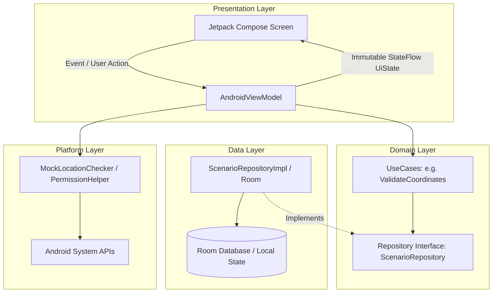

# 🏗️ 03. Panduan Pengembang & Arsitektur (Developer Guide)

Panduan ini ditujukan bagi Android software engineer, code reviewer, dan maintainer repositori **Mari Location Lab** (`com.maripartner.locationqa`).

---

## 🏛️ 1. Prinsip Arsitektur (Clean Architecture + MVVM)

Proyek ini dibangun dengan mematuhi prinsip Clean Architecture ringan yang dipadukan dengan MVVM (*Model-View-ViewModel*) dan Unidirectional Data Flow (UDF) pada Jetpack Compose.



### Aturan Arsitektural Utama:
1. **Domain Layer Bebas Android Framework**: Package `domain/` hanya memuat data class murni Kotlin dan UseCase yang dapat diuji pada JVM murni tanpa dependensi `android.*`.
2. **Presentation Layer Murni Deklaratif**: Seluruh Composable Screen (`feature/*/Screen.kt`) hanya bertindak sebagai *consumer* dari `StateFlow<UiState>` dan memancarkan aksi pengguna ke ViewModel. Tidak boleh ada pemanggilan database atau API sistem langsung di dalam Composable.
3. **Repository Pattern**: Lapisan data menyembunyikan detail penyimpanan (Room vs In-Memory vs DataStore) di balik interface yang didefinisikan pada layer domain.

---

## 📁 2. Peta Struktur Paket Lengkap

```text
com.maripartner.locationqa/
├── LocationQaApplication.kt          # Subclass Application (inisialisasi global)
├── MainActivity.kt                   # Single Activity hosting Jetpack Compose NavHost
├── core/
│   ├── common/                       # Wrapper status UI terstandarisasi (UiState.kt)
│   ├── designsystem/                 # Tema Material 3, Token Warna, Tipografi, Shapes
│   │   └── components/               # AppTopBar, AppCard, LoadingView, EmptyStateView, ErrorStateView
│   └── navigation/                   # Sealed class Screen, AppNavHost, dan AppBottomBar
├── domain/
│   ├── model/                        # Domain models: TestScenario, TestRunResult, MockLocationConfigStatus
│   ├── repository/                   # Kontrak antarmuka: ScenarioRepository
│   └── usecase/                      # Logika bisnis: ValidateCoordinatesUseCase, CheckMockLocationConfigUseCase
├── data/
│   └── repository/                   # Implementasi data: ScenarioRepositoryImpl (In-Memory / Room)
├── platform/
│   ├── mocklocation/                 # MockLocationChecker (AppOps & Developer Settings detector)
│   └── permissions/                  # PermissionHelper (Location permission status checks)
└── feature/
    ├── dashboard/                    # DashboardScreen, DashboardViewModel, DashboardUiState
    ├── map/                          # MapScreen (OSM map placeholder & coordinate validator)
    ├── scenarios/                    # ScenariosScreen (Daftar & pembuatan skenario uji)
    ├── history/                      # HistoryScreen (Riwayat waktu sesi simulasi)
    └── settings/                     # SettingsScreen (Panduan developer options & compliance)
```

---

## 🎨 3. Design System & Theme Engine

Design System mengadopsi standar **Material 3 (M3)** dengan skema warna yang dioptimalkan untuk alat developer/QA:

- **Primary Colors**: Deep Navy Blue (`#0D47A1` Light / `#90CAF9` Dark).
- **Secondary Colors**: Precision Teal (`#006874` Light / `#4FD8EB` Dark).
- **Status Indicators**:
  - `StatusSuccess` (`#16A34A`): Untuk koordinat valid dan konfigurasi terverifikasi.
  - `StatusWarning` (`#D97706`): Untuk status *"Perlu Verifikasi"* dan badge *"QA ONLY"*.
  - `StatusError` (`#DC2626`): Untuk nilai koordinat di luar rentang geografis.
- **Dukungan Dark Mode**: Diimplementasikan pada `Theme.kt` dengan mendeteksi `isSystemInDarkTheme()` dan mendukung Dynamic Color pada Android 12+ (API 31+).

---

## 🧪 4. Strategi Pengujian (TDD & Quality Gates)

Setiap logika bisnis wajib diverifikasi melalui unit test otomatis sebelum digabungkan:

### 4.1 Test Suite Eksisting (19 Test Cases)
- **`ValidateCoordinatesUseCaseTest`**: Memvalidasi aturan batas geografis:
  - Latitude valid: `-90.0 .. 90.0`
  - Longitude valid: `-180.0 .. 180.0`
  - Khatulistiwa (`0.0, 0.0`) dan koordinat Indonesia.
  - Penolakan angka di luar rentang, teks kosong, non-numerik, `NaN`, dan `Infinity`.
- **`CheckMockLocationConfigUseCaseTest`**: Memvalidasi transparansi status evaluasi Opsi Pengembang dan aplikasi mock location.
- **`ScenarioRepositoryTest`**: Memvalidasi operasi penambahan, pembacaan, dan penghapusan data skenario.

### 4.2 Menjalankan Pengujian Unit
```bash
./gradlew test
```

---

## 🔄 5. Siklus 8 Langkah Penambahan Fitur Baru

Saat menambahkan modul atau fitur baru ke codebase:

```text
1. Definisikan Model Domain  ->  domain/model/
2. Tulis Unit Test UseCase   ->  app/src/test/.../UseCaseTest.kt
3. Implementasikan UseCase   ->  domain/usecase/
4. Tentukan Kontrak Repo     ->  domain/repository/
5. Implementasikan Repo Data ->  data/repository/
6. Buat ViewModel & UI State ->  feature/<feature>/...ViewModel.kt
7. Buat Layar Composable     ->  feature/<feature>/...Screen.kt
8. Hubungkan ke NavHost      ->  core/navigation/Screen.kt & AppNavHost.kt
```

---

## 💎 6. Kebersihan Kode (Anti-Slop Standard)

1. **Strict Type Safety**: Hindari penggunaan `Any` atau casting tidak aman (`as`). Gunakan `sealed interface` untuk memodelkan seluruh status terbatas.
2. **Bebas Komentar Generik AI**: Komentar hanya boleh menjelaskan alasan desain non-intuitif (*why*), bukan mengulang baris kode (*what*).
3. **Pembersihan Debug Artifacts**: Dilarang meninggalkan `println()`, log mentah, `TODO`, atau `FIXME` yang belum terselesaikan.
